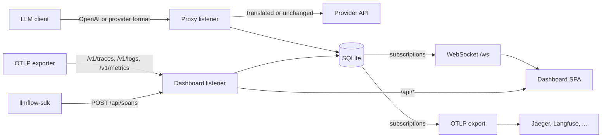
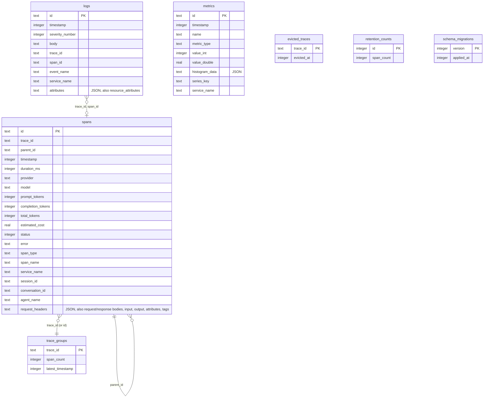

# Architecture

LLMFlow is one Bun process with two HTTP listeners and a SQLite database. This document describes how
the code is organised and how data moves through it; [README.md](README.md) covers using it.

## Processes and listeners

`apps/server/src/server.ts` starts both listeners. `bun run start`, `npx llmflow` and the Docker image
run it directly; `bun run dev:server` runs it through `apps/server/scripts/dev.ts`, which adds
busy-port fallback and dev-server discovery.

| Listener  | Default          | Serves                                                                        |
| --------- | ---------------- | ----------------------------------------------------------------------------- |
| Proxy     | `127.0.0.1:8080` | LLM API calls, translated or passthrough; `/health`, `/providers`             |
| Dashboard | `127.0.0.1:1337` | The dashboard SPA, the JSON API (`/api/*`), OTLP (`/v1/*`), WebSocket (`/ws`) |

Hosts and ports come from `PROXY_HOST`, `PROXY_PORT`, `DASHBOARD_HOST` and `DASHBOARD_PORT` through
the config module (see [Configuration](#configuration)).

## Data flow



Every write goes through `@llmflow/db` (`insertSpan`, `insertLog`, `insertMetric`), which notifies
subscribers after the insert. Two subscribers exist: `apps/server/src/live.ts` broadcasts to
dashboard WebSockets, and `@llmflow/otlp/export` queues records for export when
`OTLP_EXPORT_*` is configured.

### Proxied LLM calls

`forwardProxyRequest` in `apps/server/src/proxy.ts` handles every LLM call:

1. **Route.** `/v1/*`, `/<provider>/v1/*` or the `X-LLMFlow-Provider` header selects a provider from
   the registry (`@llmflow/providers`); `/passthrough/<provider>/*` selects one of
   `passthroughProviders`, which are the same instances.
2. **Translate or forward.** Translated calls use the provider's `getTarget`,
   `transformRequestBody` and `normalizeResponse` to map OpenAI format to the provider's API and
   back. Passthrough calls use `passthroughTarget` and forward the body and response unchanged.
   Both use `transformRequestHeaders`.
3. **Stream.** Streaming responses are relayed chunk by chunk through a `StreamSession`
   (`@llmflow/providers/stream`), which parses OpenAI, Anthropic, Gemini and Cohere stream formats
   to collect text, tool calls and usage, and re-emits OpenAI chunks for translated calls.
4. **Record.** When the response ends, one span is stored with usage and model read from the
   provider's raw response (`extractUsage`, `responseModel`) and cost from `@llmflow/pricing`.
   Credentials in headers and query strings are redacted first (`@llmflow/shared/redaction`).

### OTLP ingestion

`apps/server/src/otlp-routes.ts` accepts `POST /v1/traces`, `/v1/logs` and `/v1/metrics`.
`@llmflow/otlp/transport` decodes JSON or protobuf (the bundled OTLP proto, `proto.json`),
optionally gzip-compressed, and the signal modules (`traces.ts`, `logs.ts`, `metrics.ts`) map
records to rows. Spans are typed from GenAI attributes (`gen_ai.operation.name`, provider,
`traceloop.span.kind`, …), session and conversation IDs are taken from the attributes listed in
the README, and cost is calculated when a model and token counts are present. Rejected records are
reported in the OTLP `partialSuccess` response.

### SDK spans

`llmflow-sdk` (`packages/sdk`) posts finished spans to `POST /api/spans`. Its
`currentTraceHeaders()` and `wrapOpenAI()` put `x-trace-id` and `x-parent-id` on LLM calls, and
the proxy stores those calls as children of the SDK span.

### Replay

`POST /api/spans/:id/replay` (`apps/server/src/replay.ts`) rebuilds a stored translated request,
adds the provider key from the server environment (`@llmflow/providers/credentials`) and sends it
through `forwardProxyRequest`, which records it as a new trace.

## Dashboard JSON API

Served by `apps/server/src/api/`: a route table in `index.ts` with handlers per resource. `:id`
parameters are URI-decoded. Handlers return error responses rather than throwing; an unexpected
exception becomes a 500 with the message.

| Method | Path                    | Module        | Returns                                                                                                                                      |
| ------ | ----------------------- | ------------- | -------------------------------------------------------------------------------------------------------------------------------------------- |
| GET    | `/api/health`           | `overview.ts` | Status and pricing source                                                                                                                    |
| GET    | `/api/stats`            | `overview.ts` | Totals: `request_count`, `total_tokens`, `total_cost`, `avg_duration_ms`, `error_count`                                                      |
| GET    | `/api/services`         | `overview.ts` | Service names seen in spans, logs and metrics                                                                                                |
| GET    | `/api/models`           | `overview.ts` | Per-model aggregates for `date_from`–`date_to`                                                                                               |
| GET    | `/api/analytics`        | `overview.ts` | `daily`, `by_service`, `by_model` for the last `days`                                                                                        |
| GET    | `/api/spans`            | `spans.ts`    | Span list (filters: `model`, `status`, `q`, `provider`, `service_name`, `trace_id`, `session_id`, `conversation_id`, `date_from`, `date_to`) |
| POST   | `/api/spans`            | `spans.ts`    | Store a span (used by the SDK)                                                                                                               |
| GET    | `/api/spans/:id`        | `spans.ts`    | One span with its request and response                                                                                                       |
| GET    | `/api/spans/:id/tree`   | `spans.ts`    | Every span of the trace containing `:id`, as a tree, with totals and a `partial` flag                                                        |
| POST   | `/api/spans/:id/replay` | `spans.ts`    | Replay a captured request                                                                                                                    |
| GET    | `/api/sessions`         | `sessions.ts` | Session list and total                                                                                                                       |
| GET    | `/api/sessions/:id`     | `sessions.ts` | The traces of one session with a summary                                                                                                     |
| GET    | `/api/timeline`         | `timeline.ts` | Spans and logs merged newest first (`type`, `service_name`, `q`, `date_from`)                                                                |
| GET    | `/api/logs`             | `logs.ts`     | Log list and total                                                                                                                           |
| GET    | `/api/logs/filters`     | `logs.ts`     | Distinct services and event names                                                                                                            |
| GET    | `/api/logs/:id`         | `logs.ts`     | One log                                                                                                                                      |
| GET    | `/api/metrics`          | `metrics.ts`  | Data points, or with `aggregation=summary` totals per name, service, type and unit                                                           |
| GET    | `/api/metrics/tokens`   | `metrics.ts`  | Token/usage metrics summed per service, model and token type                                                                                 |
| GET    | `/api/metrics/filters`  | `metrics.ts`  | Distinct metric names and services                                                                                                           |
| GET    | `/api/metrics/:id`      | `metrics.ts`  | One data point                                                                                                                               |

Other dashboard-listener routes: `POST /v1/traces`, `/v1/logs`, `/v1/metrics` (OTLP), `GET /ws`
(WebSocket) and static files from the dashboard build (`apps/server/src/static.ts`).

The proxy listener (`apps/server/src/proxy-server.ts`) answers `GET /health` (span count, uptime,
provider names), `GET /providers` (every route) and `OPTIONS` itself, forwards everything else,
and adds CORS headers to every response.

## WebSocket messages

`/ws` accepts connections from trusted origins only (`apps/server/src/websocket-origin.ts`). The
server ignores client messages and sends JSON objects with a `type` and `payload`:

| `type`         | When                                         | `payload`                        |
| -------------- | -------------------------------------------- | -------------------------------- |
| `hello`        | On connect                                   | None; the message carries `time` |
| `new_span`     | Every stored span                            | Span summary (`spanSummary`)     |
| `new_trace`    | A stored span without a parent               | Span summary                     |
| `stats_update` | After a stored span, at most once per second | Same object as `GET /api/stats`  |
| `new_log`      | Every stored log                             | Log summary (`logSummary`)       |
| `new_metric`   | Every stored data point                      | Metric summary (`metricSummary`) |

## Storage

`@llmflow/db` opens one SQLite file (`DB_PATH`, default `~/.llmflow/data.db`) in WAL mode.
JSON-valued columns are stored as text; `parseTraceRow` decodes a span row's JSON columns.



- A span's trace is `COALESCE(trace_id, id)`. Triggers on `spans` keep `trace_groups` (spans per
  trace, newest timestamp) and `retention_counts` up to date.
- **Retention.** Beyond `MAX_SPANS` rows, whole traces are deleted oldest-latest-span first and
  recorded in `evicted_traces` (the newest `MAX_SPANS` markers are kept), which marks late-arriving
  spans of an evicted trace as partial. Logs and metrics are trimmed to `MAX_LOGS` and
  `MAX_METRICS`.
- **Migrations.** `packages/db/src/migrations.ts` is the only schema mechanism: it creates the
  original baseline tables if missing, then applies numbered steps not yet recorded in
  `schema_migrations`. New and existing databases take the same path; steps are appended, never
  edited. A test upgrades a real v0.4.1 database (`packages/db/src/fixtures/v0.4.1.sql`) and
  checks it ends up with the same schema as a new one.

## Modules

```mermaid
flowchart TD
    server[llmflow<br/>apps/server] --> db[@llmflow/db]
    server --> otlp[@llmflow/otlp]
    server --> providers[@llmflow/providers]
    server --> pricing[@llmflow/pricing]
    server --> devruntime[@llmflow/dev-runtime]
    server --> shared[@llmflow/shared]
    server -. builds .-> dashboard[@llmflow/dashboard<br/>apps/dashboard]
    otlp --> db
    otlp --> pricing
    otlp --> shared
    db --> shared
    pricing --> shared
    providers --> shared
    devruntime --> shared
    dashboard -. dev server .-> devruntime
    dashboard -.-> shared
    sdk[llmflow-sdk<br/>packages/sdk]
```

| Package                 | Responsibility                                                                               |
| ----------------------- | -------------------------------------------------------------------------------------------- |
| `llmflow` (apps/server) | Listeners, API routes, proxy forwarding, replay, WebSocket; the npm package and launcher     |
| `@llmflow/dashboard`    | Svelte 5 SPA built with Vite; served from `apps/server/dist/public`                          |
| `@llmflow/db`           | SQLite schema, migrations, queries, retention, subscriptions                                 |
| `@llmflow/providers`    | Provider adapters, registry, passthrough providers, stream parsing, API keys for replay      |
| `@llmflow/otlp`         | OTLP decoding and ingestion; OTLP export                                                     |
| `@llmflow/pricing`      | LiteLLM pricing with bundled pricing for offline use; cost calculation                       |
| `@llmflow/shared`       | Config (every environment variable), logger, redaction, bounded body reader, network helpers |
| `@llmflow/dev-runtime`  | Development only: busy-port fallback and discovery between dev servers                       |
| `llmflow-sdk`           | Tracing SDK for applications; published separately, depends on nothing                       |

Workspaces depend on each other with `workspace:*` and import by package name. The dashboard talks
to the server only over HTTP and WebSocket.

## Configuration

`packages/shared/src/config.ts` declares every environment variable (`SETTINGS`) and exposes typed
getters (`config`). It is the only code that reads `process.env`; a test enforces this.
`.env.example`, the README configuration table and `llmflow --help` are generated from `SETTINGS`
by `bun run env:docs`, and a test checks they match. Values are read when accessed, so tests and
dev scripts can set variables before importing a module.

## Build and packaging

`bun run build` (`apps/server/scripts/build.ts`) builds the dashboard and bundles `src/server.ts`
with its workspace dependencies into `apps/server/dist/server.js` (linked source map), copying the
dashboard to `dist/public/`. Bundled pricing is embedded in the bundle. The npm package
contains `bin/`, `dist/`, `README.md` and `LICENSE`; `bin/llmflow.js` runs on Node and starts
`dist/server.js` (or `src/server.ts` in a checkout) with Bun. `bun run test:package` packs and
checks both the `llmflow` and `llmflow-sdk` tarballs. The Docker image builds the same layout from
source.

## Vocabulary

The domain glossary (span, trace, session, service, cost, and the rest, with the words to avoid) is
[CONTEXT.md](CONTEXT.md). Use its terms in code, API JSON, the UI and docs. Some identifiers predate
it (for example the `trace` key on a single span, `request_count`, `prompt_tokens`) and are being
renamed; until then this document names the identifiers as they are in the code.

Naming conventions for identifiers: API JSON is snake_case only, durations are `duration_ms` /
`avg_duration_ms`, millisecond settings end in `_MS`, the default host is `127.0.0.1`, and client
environment variables are `LLMFLOW_URL` (dashboard and API) and `LLMFLOW_PROXY_URL` (proxy).

## Decisions

### Rename the `traces` table and `/api/traces` to spans (2026-09-23, TASK-95)

**Decision: rename.** The `traces` table stores one row per span, `/api/traces/:id` takes a span
id, `MAX_TRACES` counts span rows, and `POST /api/spans` already wrote into it. Calling rows
"traces" made the code and API contradict themselves wherever a trace (a group of spans) and a
span meet: the span tree endpoint, eviction, and the proxy `/health` count.

- Cost: one migration (`ALTER TABLE traces RENAME TO spans`; SQLite carries indexes and
  triggers along), a rename across the DB module, API, dashboard stores and e2e specs, and a
  breaking change for anyone calling `/api/traces` or setting `MAX_TRACES`. LLMFlow is pre-1.0
  and the dashboard is the only known API consumer.
- Benefit: the schema, API and docs say what they store; "trace" is left for what it means in
  OpenTelemetry, a group of spans.
- `MAX_TRACES` becomes `MAX_SPANS`; the old name is still read as a fallback.
- Carried out in TASK-105.
